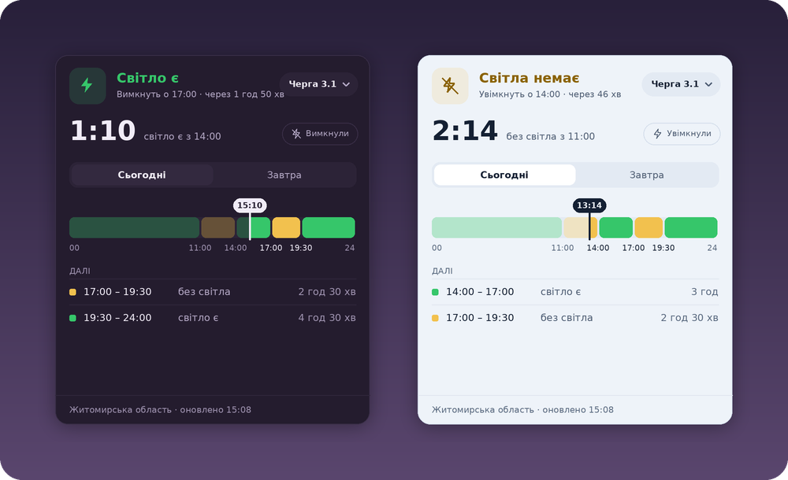

<h1 align="center">Lumos</h1>

Графік відключень світла в треї Windows

<a href="https://github.com/dimasdonetsk/Lumos/releases/latest"><b>Завантажити Lumos-win-Setup.exe</b></a>

Графік відключень світла для Windows: плашка вгорі екрана і іконка в треї.

- ⚡ зелена блискавка — світло є, і таймер до відключення
- перекреслена жовта блискавка — планове відключення, таймер до увімкнення
- червоний трикутник — аварійні відключення, графік не діє
- клік по плашці — графік на сьогодні й завтра, список проміжків, вибір черги
- правий клік по іконці в треї — область, черга, попередження, тема (темна сливова / світла морозна) та інше
- сповіщення перед відключенням і коли з’являється графік на завтра
- аварійні відключення: позначка «аварійні» з сайтів ДТЕК, заголовок сторінки Укрзалізниці, Telegram-канали Укренерго, ДТЕК та обленерго — статус червоніє, коли там свіже повідомлення про аварійні відключення у твоїй області
- два постачальники: обленерго (ДТЕК) або **Укрзалізниця** — для будинків, що живляться від мережі залізниці (графіки з uz.gov.ua)
- кнопка «У мене немає світла» — якщо світла немає не за графіком (сама знімається через 12 годин)

## Встановлення

1. Відкрий [останній реліз](https://github.com/dimasdonetsk/Lumos/releases/latest) і завантаж **Lumos-win-Setup.exe**.
2. Запусти. Windows може показати «Windows захистила ваш ПК» — **Докладніше → Виконати однаково** (програма не підписана сертифікатом).
3. Lumos встановиться у `%LocalAppData%\Lumos`, з’явиться в меню Пуск і запуститься.

Оновлення ставляться самі: програма перевіряє GitHub за 2 хвилини після запуску і далі раз на 6 годин.
Вручну — правий клік по значку → **Перевірити оновлення**. Видалити — через «Програми» в налаштуваннях Windows.

## Як випустити нову версію

Змінити `<Version>` у `src/Lumos.csproj` і запушити в `main`. GitHub Actions збере програму,
створить реліз із інсталятором і пакетом оновлення, і всі встановлені копії підтягнуть його самі.

Зібрати локально: встанови [.NET 8 SDK](https://dotnet.microsoft.com/download/dotnet/8.0) і запусти `build.bat`.

## Області без графіків

Lumos показує графіки всіх областей, де їх публікують у вигляді, який програма може прочитати.
Для трьох областей зараз такого способу немає:

| Область | Як публікують зараз | Що потрібно, щоб запрацювало |
|---|---|---|
| **Волинська** | Волиньобленерго викладає графік лише картинкою (PNG) | Найкраще — щоб обленерго публікувало графік текстом або JSON (дані в них уже є, картинку малюють із них). Інший шлях — розпізнавати кольори клітинок на картинці; це можна додати в Lumos, але він ламатиметься щоразу, коли обленерго змінить вигляд картинки. Також підійде відкрите дзеркало, яке хтось уже веде (як для Вінниччини). |
| **Сумська** | API Сумиобленерго з 19.10.2026 відповідає лише їхньому власному сайту, а в новинах графік картинкою | Щоб обленерго знову відкрило API або писало графік текстом у Telegram-каналі (як Кіровоградобленерго). Обходити захист сайту Lumos не буде. |
| **Херсонська** | Графік видно лише в особистому кабінеті після входу | Щоб Херсонобленерго публікувало графік відкрито: на сайті, в Telegram чи як відкриті дані. Входити в чужі кабінети програма не може і не повинна. |

Якщо ти з однієї з цих областей і бачиш графік текстом десь у відкритому доступі (Telegram-канал, сторінка сайту),
напиши в [Issues](https://github.com/dimasdonetsk/Lumos/issues) — його можна буде підключити.
Споживачі **Укрзалізниці** мають графік у всіх областях: «Постачальник → Укрзалізниця».

## Дані

Графіки беруться з відкритого агрегатора
[UA Power Outages Monitor](https://github.com/chaichuk/UA-power-outages-monitor), який оновлюється кожні 5 хвилин.
Останні дані зберігаються локально, тому без інтернету програма показує останній відомий графік.

Налаштування, кеш і журнал помилок лежать у `%AppData%\Lumos`.

## Структура

| Файл | Що робить |
|---|---|
| `src/ScheduleData.cs` | завантаження і розбір графіків, кеш |
| `src/StatusEngine.cs` | статус «зараз», найближчі зміни, проміжки |
| `src/OverlayWindow.xaml` | вигляд плашки і графіка |
| `src/OverlayViewModel.cs` | тексти, кольори, клітинки графіка |
| `src/TrayController.cs` | іконка в треї і чорне меню |
| `src/AppController.cs` | таймери, сповіщення, налаштування |
| `src/Theme.cs` | темна і світла теми |
| `src/Updater.cs`, `src/Program.cs` | інсталятор і автооновлення (Velopack) |
| `src/UzSource.cs` | графіки Укрзалізниці |
| `src/ExtraSources.cs` | Вінницька, Одеська, Дніпропетровська, Миколаївська, Кіровоградська області |
| `src/EmergencyMonitor.cs` | пошук аварійних відключень у Telegram-каналах |
